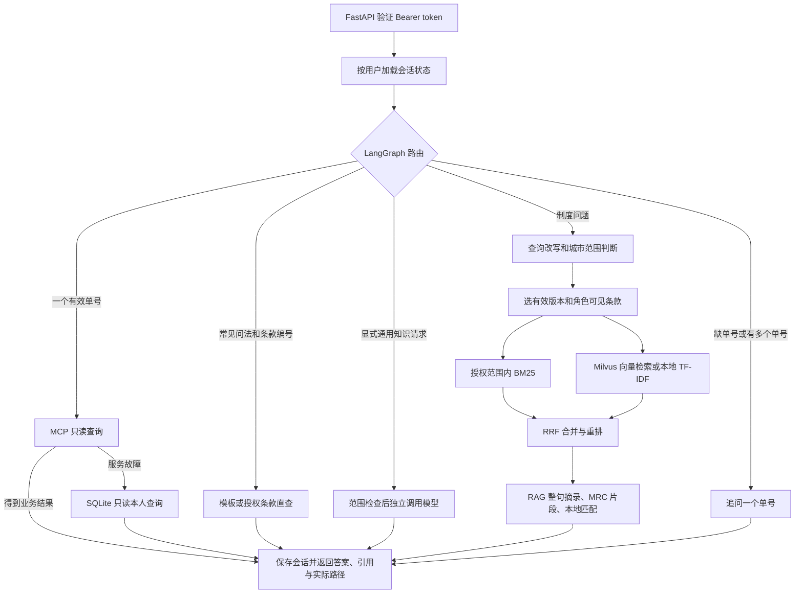

# 架构与权限设计

## 业务边界

这个项目模拟一家企业的费用报销流程，回答职工能看到的制度，并读取职工本人的审批状态。制度、用户和审批数据均为虚构样例。审批 MCP 只提供一个读工具，业务服务使用 SQLite 的只读连接访问单据。

## 制度版本与预过滤

1. 数据文件按制度保存多个版本，每一版有生效日期、角色列表和独立条款。条款 ID 形如 `TRAVEL@2025#A1`，同一条款换版时使用新的 ID。
2. 对每部制度，在 `as_of` 当日及以前选择最新生效版本。再从这一版筛出当前角色可访问的条款。这样即使旧版权限更宽，新版权限收紧后也不会意外回退到旧版。
3. BM25 在已过滤的文档集合计算词频和文档频率。默认向量路径在同一集合算 TF–IDF 余弦相似度。启用 Milvus 后，检索请求用允许的条款 ID 作为服务端过滤表达式，并在应用侧再次检查返回 ID。
4. 问答时从每路拿最多 10 条候选，用 RRF 合并。同一条款出现在两路时，合计 `1 / (60 + rank)`。可选 BGE 对问题和条款打分。模型未配置或不可用时，根据命中主题的具体程度重排。结果最多返回 5 条用于证据筛选。

默认中文分词使用相邻汉字二元组，拉丁字符和数字按词处理。示例用它解释检索原理，处理大语料时可替换为业务词典与专用分词器。Milvus 存储条款 ID 和向量，显示的正文始终从选中的制度原文取得。更换模型、向量维数、制度内容或权限时，新索引用新的集合指纹。

## 引用和无答案

1. 默认本地摘录根据问题中的主题短语选证据。在「没有发票」和「发票」这类重叠主题中，优先选择更具体的主题。
2. 配置 Qwen 后，先让模型从可见候选中选择和组织原文整句。应用核对条款 ID、完整句边界、原文内容和已命中的全部条款。RAG 没找到、漏掉已有证据或发生故障时，继续尝试本地路径。
3. 可选 MRC 从本地匹配到的条款中定位答案起止位置。每个片段必须和条款中的对应字符一致，且分数达到 0.6。这个阈值是演示设定，需按实际模型和语料评估。
4. MRC 未配置、低分、返回异常或发生故障时，返回本地匹配的完整条款。如果没有可验证条款，返回 `no_evidence`。对缺少城市的住宿限额问题，先请用户补充范围。提到目的地但无法确认其类别时，可同时展示两类国内标准。明确询问境外住宿时，提示当前制度范围。

每条制度答案和引用都显示完整原文，避免只看定位片段时漏掉上限、适用对象和例外。原文一致性和语义相关性分别评估。通用知识问答由「通用知识：」显式触发，独立请求模型。识别为企业制度或单据的输入会提示使用制度问答。

## 审批查询与会话

- `/v1/chat` 从 Bearer token 解出用户与角色，忽略用户文本中自行声明的身份。
- LangGraph 识别一个形如 `BX-1001` 的单号。询问审批进度但缺号，或同时出现多个单号时，返回追问。明确切到制度问题时，会话退出追问状态。
- MCP 客户端走本机标准输入输出，启动后检查服务只暴露 `lookup_approval`。服务独立解析调用者凭证，并使用参数绑定查询 `id AND owner`。财务身份不会扩大本人单据的范围。
- MCP 启动或调用故障时，应用继续用同一个 SQLite 库，复用 MCP 的身份和归属校验。无权限或单号不存在时直接返回同样的提示。两路都不可用时返回 `approval_service_error`。
- SQLite 会话表只保存随机 ID、用户、版本号和是否等待单号。每次提交使用版本号防止旧请求覆盖新状态。同一会话的并发冲突返回 409。
- 凭证只在 API 和本机 MCP 服务之间传递，模型只看到问题与已过滤条款。应用关闭 LangSmith 跟踪，避免把原始输入和审批返回发送到外部追踪服务。

## 文件入口

| 路径 | 职责 |
| --- | --- |
| `enterprise_agent/api.py` | 接口、身份校验、会话调用 |
| `enterprise_agent/agent.py` | LangGraph 分支、API 到检索和工具的串联 |
| `enterprise_agent/routing.py` | 规则、意图识别和查询改写 |
| `enterprise_agent/policy.py` | 条款加载、版本筛选和角色可见性 |
| `enterprise_agent/retrieval.py` | BM25、TF–IDF、RRF 和可选 BGE 重排 |
| `enterprise_agent/milvus_backend.py` | 向量索引、预过滤、结果检查 |
| `enterprise_agent/evidence.py` | 可选 Qwen、MRC 和原文字面校验 |
| `enterprise_agent/approval_mcp.py` | 本机只读审批工具 |
| `enterprise_agent/mcp_client.py` | MCP 会话、工具响应验证和 SQLite 降级 |
| `enterprise_agent/data/chat.html` | 聊天界面、引用和处理路径 |
| `enterprise_agent/storage.py` | SQLite 会话和审批数据 |
| `enterprise_agent/evaluate.py` | 固定题集评测与逐题 JSON |

上线到真实企业前，需要接入企业身份提供方、替换模拟审批存储、设置保留期限并按组织环境验证审计和隔离。本项目的 Bearer 配置和本机进程划分用于展示实现。
